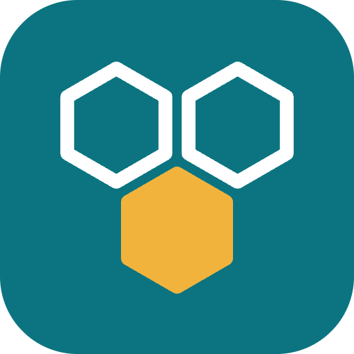
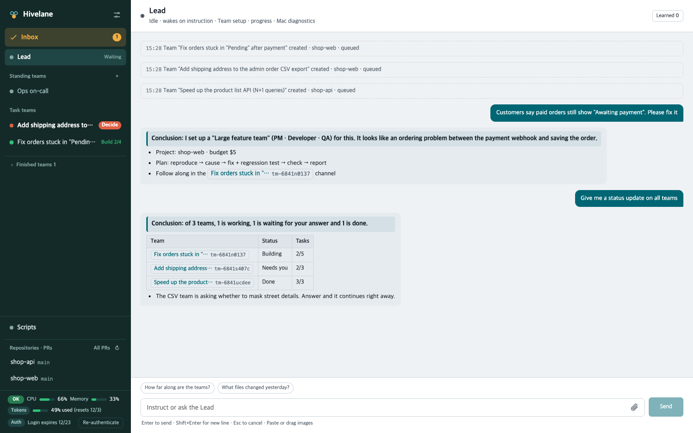
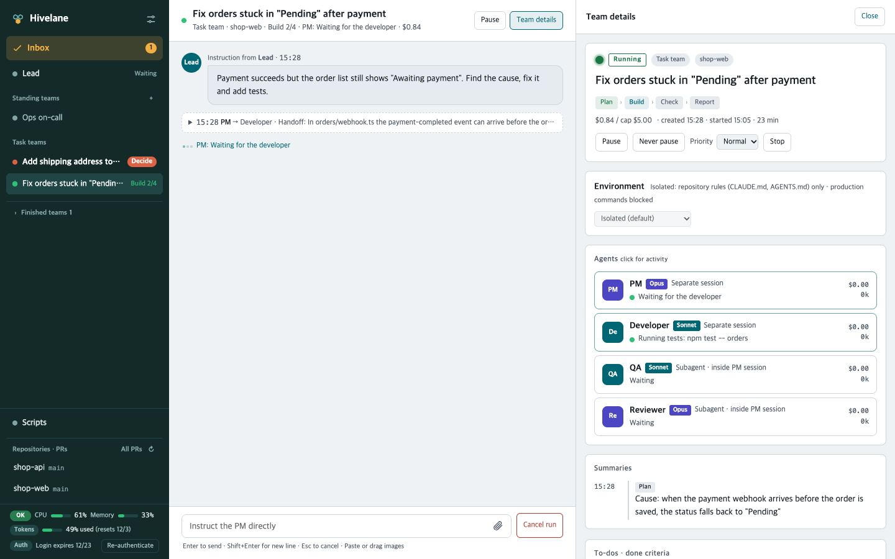
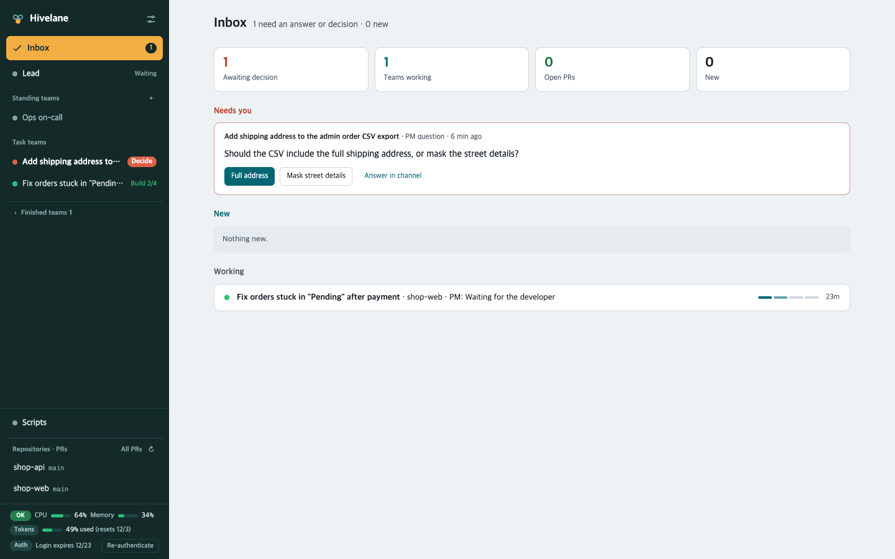
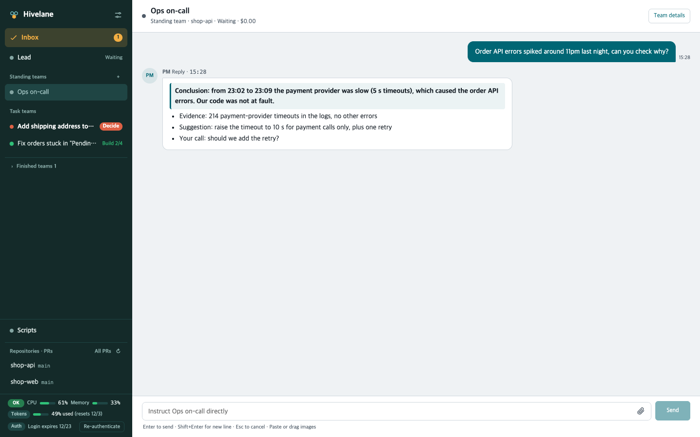
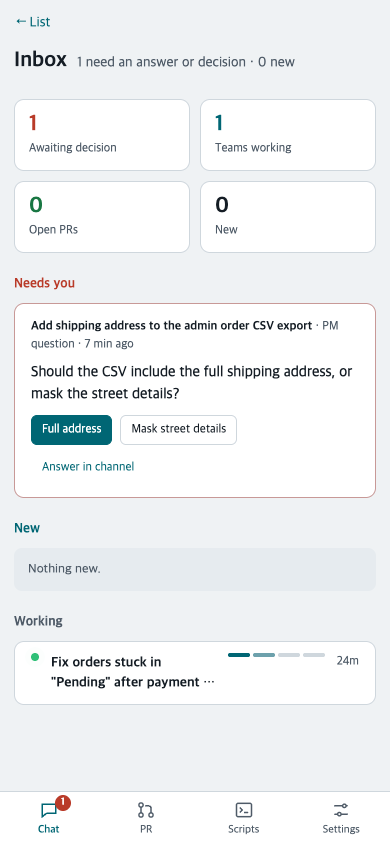
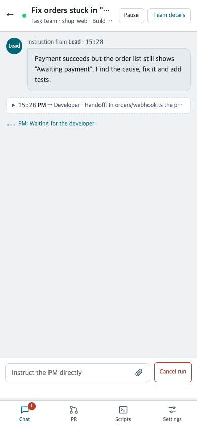
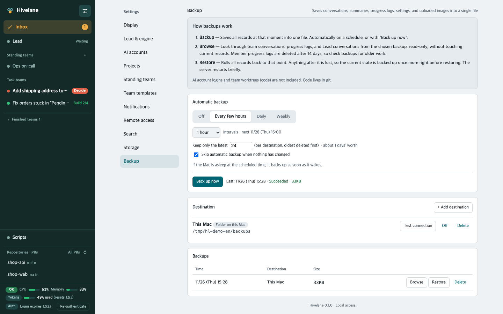
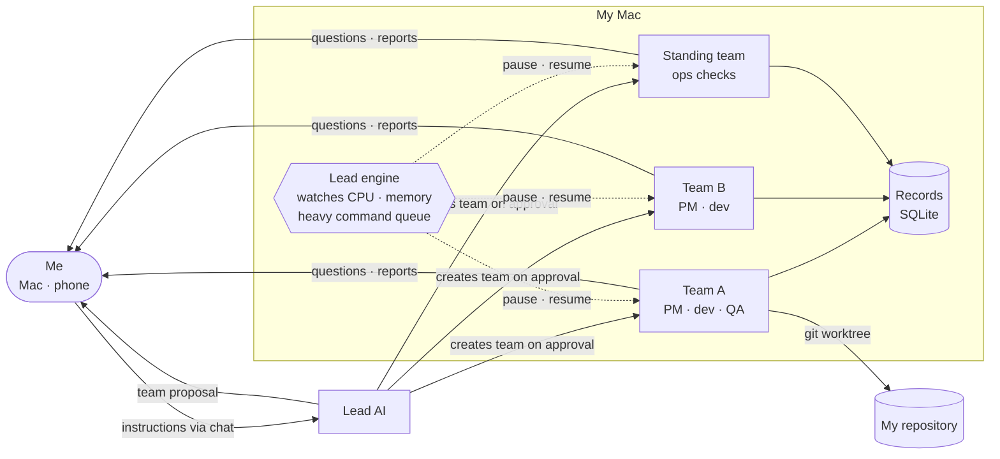

<p align="center">
  
</p>

<h1 align="center">Hivelane</h1>

<p align="center">
  <b>A control room on your Mac: run several AI dev teams and hand them work through a messenger</b><br />
  Tell the Lead AI what you need. It puts together a team (PM, developer, QA), the teams work in parallel, and you only step in when a decision is needed.
</p>

<p align="center">
  <a href="#getting-started">Getting started</a> ·
  <a href="#what-it-can-do">What it can do</a> ·
  <a href="#how-it-compares-to-similar-tools">Compared with similar tools</a> ·
  <a href="#faq">FAQ</a> ·
  <a href="docs/en/GUIDE.md">User guide</a> ·
  <a href="https://webjihong.github.io/hivelane/">Website</a>
</p>

[한국어](README.md) · **English**

<p align="center">
  
</p>

---

## What is Hivelane?

AI coding tools such as Claude Code are smart, but they handle **one task at a time, with you sitting at the terminal**.
With several tasks, you end up juggling terminal windows, remembering who is doing what, and shutting things down yourself when your Mac slows to a crawl.

Hivelane turns this into something that works **like a company**.

| At a company | In Hivelane |
|---|---|
| You tell your manager "please take care of this" | You tell the **Lead** (an AI) in a chat |
| The manager puts together the right team | The Lead **proposes a team** (PM, developer, QA, …), and the team is created when you approve |
| Teams work at their own desks at the same time | Each team works at the same time in its **own separate working folder** (git worktree) |
| When a decision is needed, they ask you | When a team gets stuck it posts a **question**, and you answer with one click |
| When the office gets crowded, schedules are adjusted | The **Lead engine** watches your Mac's CPU and memory and pauses and resumes teams |
| Meeting notes and reports are kept | Every conversation, command and changed file is **recorded**, searchable and backed up |

Everything runs **on your Mac**. Your code and records never go to another server, and Hivelane uses the Claude (or ChatGPT) subscription you already have.

### Who it's for

- **Solo developers and small teams** running several projects at once on a single Mac
- People who already use Claude Code and want to **hand off several tasks at once and just check the results**
- People who want to **follow progress and answer from their phone** on the go
- People who want AI working on their Mac, but with **risky things like production databases and deploys always requiring their approval**

---

## What it can do

### 1. Say what you need, and the Lead builds a team

Say something like "Payment went through, but the order still shows as awaiting payment. Please fix it," and the Lead sizes up the job and proposes a team (PM, developer, QA, reviewer, models, budget). Approve it and the team is created and starts right away. Ask "Give me a rundown of where the teams are" and you get a table (screenshot above).

### 2. Teams work on their own while you watch



Each team has its own channel where you can see, in real time, its stage (**Plan → Build → Check → Report**), its to-do list, what each member (agent) is doing right now, and how much it has spent. Click a member to see which commands it ran and which files it changed. You can jump in at any time to give instructions directly or pause the team.

### 3. You only make the decisions



The **Inbox** gathers only **what needs your answer**, plus the teams that are working. You answer a team's question right there with option buttons. When answers or reports arrive, you're notified via macOS notifications, phone push notifications or Slack.

### 4. Standing teams, always on call



For things you ask for often, like server checks or incident response, set up a **standing team** and instruct it directly without going through the Lead. Answers always come as "one-line conclusion + supporting evidence". If it dies, it revives itself.

### 5. On your phone, too

<p>
  
  &nbsp;&nbsp;
  
</p>

You connect only from your own phone through [Tailscale](https://tailscale.com) (nothing is exposed to the internet). Add it to your Home Screen to use it like an app and get push notifications. With the Mac app, the honeycomb icon in the menu bar tells you when teams are working and when something needs your attention.

### 6. Keeping your Mac from struggling: the Lead engine

Every 5 seconds it measures CPU and memory and adjusts how many teams run according to three zones: **OK / Busy / Overloaded**. When things get busy it pauses the least urgent teams first, and resumes them when there's room again. Heavy commands like tests and builds run one after another from a **queue**, so several teams building at once can't freeze your Mac.

### 7. Records, search and backup



Conversations, tool runs, changed files and summaries are all kept and searchable in Korean, too ("Which files changed yesterday?"). Records are backed up automatically to **a folder on this Mac, a Synology NAS or AWS S3**, anywhere from every 30 minutes to once a week, and you can **browse** past backups without touching your current records.

### 8. AI accounts and models per team, and work that continues when limits run out

- **Multiple accounts**: Connect several Claude accounts and Codex (OpenAI) accounts, and see each account's plan usage (5-hour and weekly %).
- **A model and account for each team and role**: Choose per role, even within one team, e.g. "PM on Opus with the work account, developer on Sonnet with the personal account, reviews by Codex". The Lead gets its own choice too.
- **Uninterrupted tokens**: When the account in use passes a threshold (e.g. 90%), the next account is borrowed, and it switches back automatically once the limit resets. Even when the account changes, **the ongoing conversation continues as is**, so members don't have to start over.

For details, see [User guide › AI accounts and models](docs/en/GUIDE.md#8-ai-accounts-and-models).

### 9. And more

- **PRs, repositories, scripts**: See checks and reviews on open PRs and merge them, and run frequently used terminal commands with a button (from your phone, too).
- **Safety rails**: Teams can't write outside their own working folder, and dangerous commands like `git push --force` and `rm -rf` are blocked. Production database and deploy commands only run after **human approval**. Commits and pushes must be allowed per project.

---

## How it works



- Team members run on the [Claude Agent SDK](https://docs.anthropic.com/en/docs/claude-code/sdk) (= Claude Code), and optionally on the [Codex SDK](https://github.com/openai/codex).
- Each task gets a **new branch + git worktree** in the repository, so it never mixes with the folder you're working in or with other teams.
- A single server (Node) runs on your Mac at all times, and the UI is a web page served by that server (the Mac app is a wrapper around that web page).

---

## How it compares to similar tools

There are already several tools for running multiple AI coding agents at once. Most focus on **"launching lots of sessions for you"**; Hivelane adds **"dividing up and managing the work"** on top of that.

| | Plain Claude Code | Parallel-session tools<br/>(e.g. [Conductor](https://www.conductor.build), [Claude Squad](https://github.com/smtg-ai/claude-squad), Crystal, Vibe Kanban) | Cloud agents<br/>(e.g. Codex cloud, Devin) | **Hivelane** |
|---|---|---|---|---|
| Who divides up the work | You | You (instructing each session yourself) | You (per task) | **The Lead AI proposes the team**, you approve |
| Roles within one task | One agent (+ subagents) | One agent per session | One agent | **A PM delegates to developer, QA and reviewer** |
| Task isolation | Same folder | git worktree | Cloud container | git worktree |
| Mac load management | None | Mostly none | N/A (cloud) | **Pauses and resumes teams based on CPU and memory, heavy command queue** |
| Human check-ins | Answer in the terminal | Per session in the app | On the web | **Only questions gathered in the Inbox, answered with buttons** · approval required for production commands |
| Phone | Limited | Mostly desktop-only | Web | **Messenger-style web + push notifications** (Tailscale) |
| Always-on teams | None | None | None | **Standing teams** (checks and incident response, revive themselves) |
| Unit for choosing model and account | One per session | One per session (task) | Per task | Model and account **per role within a team** (mix Claude and Codex) |
| When usage limits run out | Wait, or log in again yourself | Wait, or switch yourself | Depends on your plan | **Switches to the next account automatically, conversation continues as is** · switches back once the limit resets |
| Records | Session history | Per session | Inside the service | **Search across every conversation, command and change + NAS/S3 backups** |
| Where code and data live | Your Mac | Your Mac | Cloud | Your Mac |
| Cost | Your subscription | Your subscription (+ app fees in some cases) | Separate fees | Your existing Claude / ChatGPT subscription; Hivelane itself is free (MIT) |

> Information about other tools is a summary of what their public materials said as of November 2026, so it may have changed since. If you prefer handling each session yourself, a parallel-session tool may suit you better; if work has to continue while your Mac is off, a cloud agent may be a better fit.

**In one line**: if other tools are "a desk that spawns several AI workers," Hivelane is closer to "setting up a small company, with a manager and teams, inside your Mac."

---

## Getting started

You'll need **macOS** (Apple Silicon recommended) and a **Claude subscription** (Pro, Max, etc.; you just need to be logged in to `claude`, no API key required). To use Codex, you'll also need a ChatGPT subscription or an OpenAI API key.

### Install with Homebrew (easiest) — one-line updates

```bash
brew tap webjihong/hivelane https://github.com/webjihong/hivelane
brew trust webjihong/hivelane     # Homebrew 7+: allow this tap
brew install --cask hivelane

# when a new version is out
brew upgrade --cask hivelane
```

Open Hivelane and click "Install server and start". After an update the server restarts on the new version by itself once no team is working. Like the DMG, the first launch needs "Open Anyway" once (not notarized yet).

### Install the Mac app (recommended), no terminal needed

1. Download `Hivelane-<version>-arm64.dmg` from **[the latest release](https://github.com/webjihong/hivelane/releases/latest)**.
2. Open the DMG and drag Hivelane into your **Applications** folder.
3. If you get an "unidentified developer" warning the first time you open it, click **System Settings › Privacy & Security › Open Anyway** once.
4. On the setup screen, click **"Install server and start"**, then finish logging in to Claude.

You don't need to install anything else, such as Node.js. A detailed walkthrough for first-timers (connecting your phone, updating to a new version, uninstalling) is in the **[Mac app guide](docs/en/MAC_APP.md)**. What changed in each version is in the [changelog](CHANGELOG.en.md).

<details>
<summary><b>Install from source (optional): for developers who want to modify the code or build it themselves</b></summary>

You'll need Node 22 or later and git.

```bash
git clone https://github.com/webjihong/hivelane.git
cd hivelane
npm install
npm run service:install   # builds the UI → starts automatically when you log in to your Mac (launchd) → tailscale serve for your phone (if installed)
open http://127.0.0.1:4310
```

For details (always-on mode, phone access, updating and uninstalling, troubleshooting), see the **[installation guide](docs/en/INSTALL.md)**.

</details>

### Your first 5 minutes

1. In **Settings › Projects**, pick the git repository you want teams to work on (choose the folder in Finder).
2. Tell the **Lead** channel what you want done. For example: "The product list in shop-web is slow. Find the cause and fix it."
3. On the team proposal card from the Lead, click **Approve and start**.
4. Follow progress in the team channel and answer any questions. When the team finishes, its report and changed files are kept.

> The UI follows your Mac or browser language the first time (Korean or English). AI replies and notifications are Korean by default; to get them in English, set **Settings › Lead & engine › AI reply & notification language** to English.

---

## Good to know

- Hivelane lets **AI modify files and run commands on your Mac**. There are guards (no writing outside the working folder, dangerous commands blocked, approval for production commands), but they're not perfect. Back up important repositories and review the "Blocked commands" in each project's settings.
- Teams use **your Claude (or ChatGPT) subscription usage**. Running many teams at once will hit your limits quickly. You can set a budget cap per task, and see usage (%) in the sidebar.
- Remote access is allowed **only within your Tailscale network**, and only for the registered owner account. Don't expose it directly to the internet.

## FAQ

<details>
<summary><b>Do I need an API key? How much does it cost?</b></summary>

No. If you're logged in to `claude` (Claude Code) on your Mac, Hivelane runs on that subscription. Hivelane itself is free (MIT). Costs come out of your subscription usage, and the UI shows each team's spend (estimated in dollars) and your plan usage (%).
</details>

<details>
<summary><b>Does it work on Windows or Linux?</b></summary>

Only macOS is supported for now (it relies on Mac features such as launchd for always-on running, macOS notifications and the menu bar, and sleep prevention).
</details>

<details>
<summary><b>What if my Mac shuts down or goes to sleep?</b></summary>

While the server is running, it keeps your Mac from sleeping (when plugged in). After a shutdown and restart, the server comes back up on its own and teams pick up where they left off. Any automatic backups that were missed run as soon as the Mac wakes up.
</details>

<details>
<summary><b>What if the AI breaks my code?</b></summary>

Teams only make changes in a separate branch and working folder created for each task, so your own working folder and main branch stay untouched. Commits and pushes must be allowed per project, and a finished team's working folder is cleaned up only after its changes are saved as a patch.
</details>

<details>
<summary><b>I already use Claude Code subagents and parallel sessions. Why this?</b></summary>

You keep using them. Hivelane's team members are Claude Code, and you can even let them use your own Claude Code settings, plugins and MCP servers (the per-team "Environment" setting). On top of that, Hivelane divides up the work, manages your Mac's load, and gathers questions, reports and records in one place.
</details>

<details>
<summary><b>Is the UI Korean only?</b></summary>

No. The UI is available in Korean and English. Choose it in **Settings › Display › Language**; it's saved per device, and the first time it follows your Mac or browser language. The language the Lead and teams answer in, and that notifications are written in, is a separate setting: **Settings › Lead & engine › AI reply & notification language**. The Mac app's menu bar and setup screen follow your Mac's language. Some docs, such as the design spec, are only available in Korean.
</details>

---

## Documentation

| Document | Contents |
|---|---|
| [Mac app guide](docs/en/MAC_APP.md) | **Recommended way to install.** Installing and using the DMG (no terminal), updating to a new version, making a release |
| [Changelog](CHANGELOG.en.md) | What changed in each version |
| [Installation guide](docs/en/INSTALL.md) | (Optional) Installing from source, always-on mode, phone access (Tailscale), updating and uninstalling, troubleshooting |
| [User guide](docs/en/GUIDE.md) | Screen layout, handing work to the Lead, team channels, PRs and scripts, settings, safety rails |
| [Spec](docs/SPEC.md) | Design and behavior rules (for developers, Korean only) |

## Development

```bash
npm run dev          # server (4310, tsx watch) + UI (4311, Vite)
npm test             # unit tests (vitest)
npm run typecheck
npm run e2e          # run one team on a practice repository with real Claude (Haiku) (a few cents)
```

During development, use a separate data folder, e.g. `HIVELANE_HOME=/tmp/hl-dev npm run dev`, so you don't mix it with your real data.

<details>
<summary>Retaking the README screenshots (with fake demo data)</summary>

```bash
HIVELANE_HOME=/tmp/hl-demo npx tsx scripts/readme-demo.ts            # fake projects, teams, conversations → prints team ids
HIVELANE_HOME=/tmp/hl-demo HIVELANE_PORT=4391 npx tsx server/index.ts  # demo server (in another terminal)
HL_URL=http://127.0.0.1:4391 HL_TEAMS='<JSON printed above>' npx electron scripts/readme-shots.mjs   # docs/images/*.png
```

Don't take them with real data (names, emails and paths may show up).
</details>

<details>
<summary>Code structure</summary>

```
server/
  index.ts            boot, shutdown, sleep prevention
  store.ts            SQLite access (all records)
  agents/             Agent SDK and Codex runners · path and command guards · role instructions
  teams/              team creation, PM turn loop, questions/answers, pause/resume, standing teams, recovery · PM-only tools
  po/                 Lead agent and tools · engine (measurement, policy) · heavy command slots · plan usage · re-authentication
  accounts.ts         multiple AI accounts · usage-based switching
  backup/             backup (folder on this Mac, WebDAV, S3) · browse · restore
  projects/           worktrees, PRs, repository status, git cleanup
  search/             FTS5 (Korean trigram) + optional vector search
  http/app.ts         REST, SSE, access control
web/src/              React UI (channel list, Inbox, Lead, team channels, PRs, scripts, settings), PWA
desktop/              Mac app (Electron): first-run setup, menu bar, notifications
shared/               types and helpers shared by server and UI
```
</details>

## License

[PolyForm Noncommercial 1.0.0](LICENSE) — free to use and modify for **noncommercial purposes** (personal use, study, research, nonprofits). **Commercial use** (work at a company, paid services, resale) needs a separate license — please ask via [GitHub issues](https://github.com/webjihong/hivelane/issues).

Versions up to v1.0.2 were released under MIT and stay under MIT.
