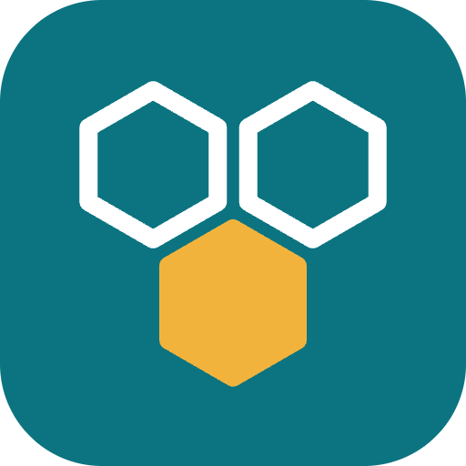
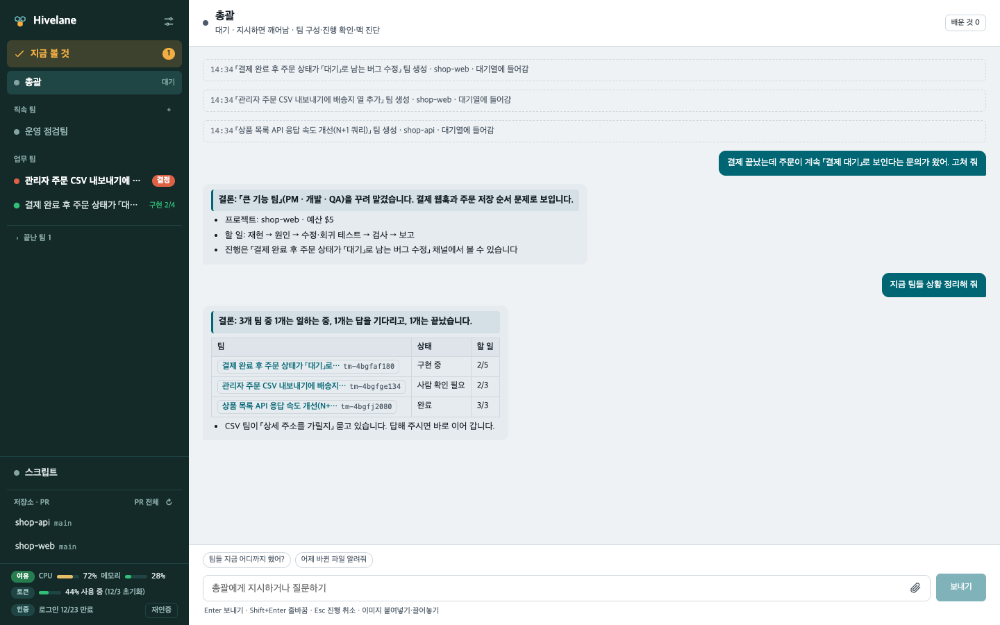
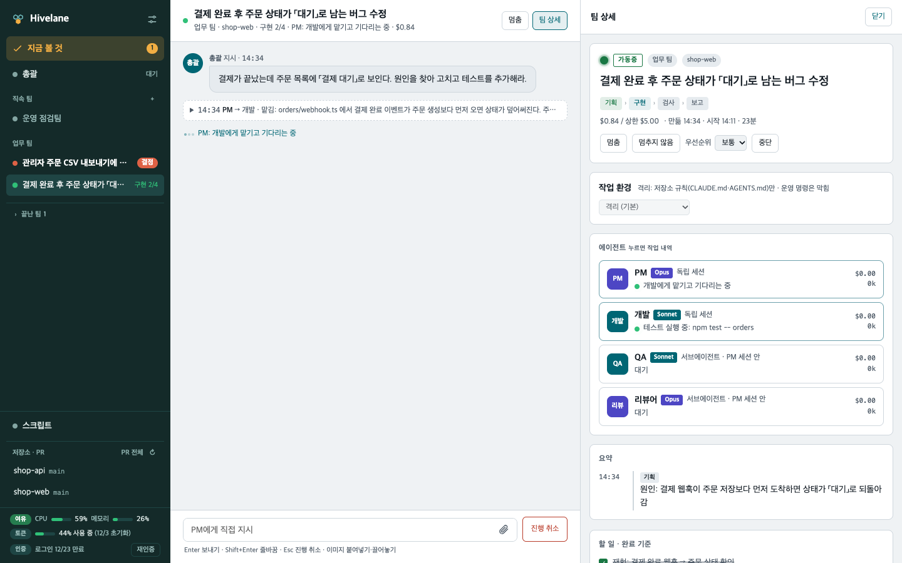
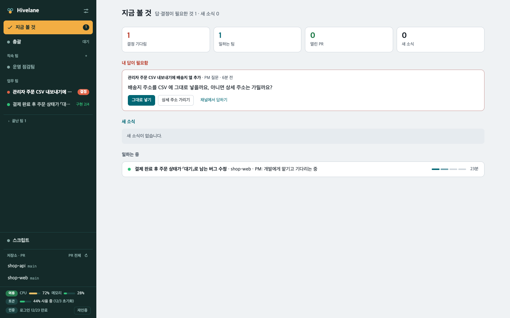
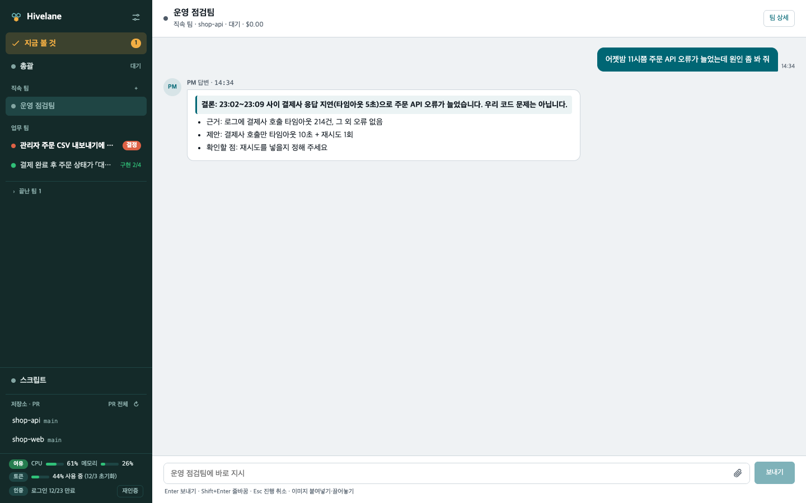
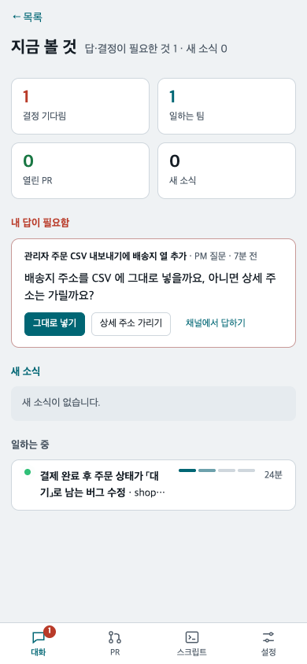
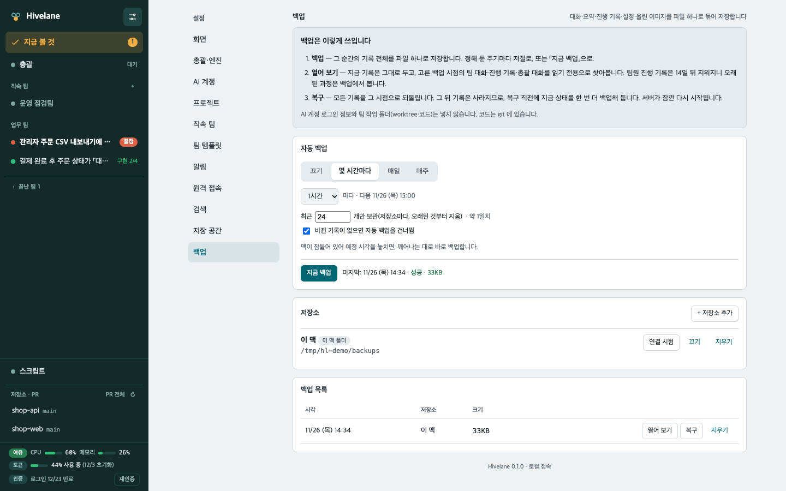
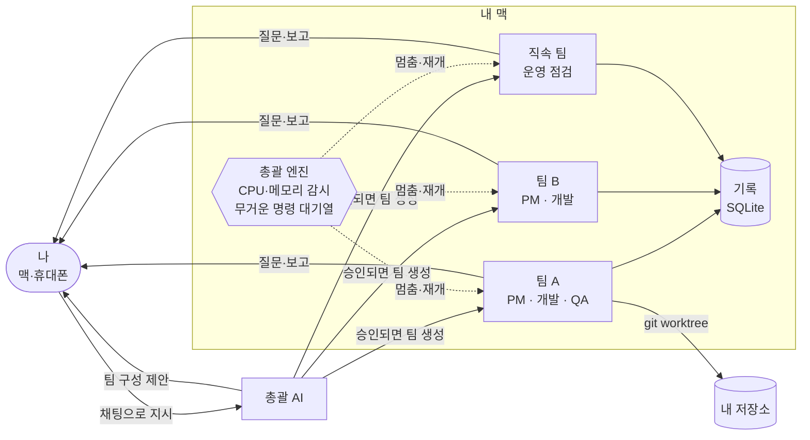

<p align="center">
  
</p>

<h1 align="center">Hivelane</h1>

<p align="center">
  <b>내 맥 안에 AI 개발팀을 여러 개 두고, 메신저로 일을 맡기는 관제실</b><br />
  말로 지시하면 총괄 AI가 팀(PM·개발·QA)을 꾸려 맡기고, 팀들은 동시에 일하며, 나는 결정이 필요할 때만 답합니다.
</p>

<p align="center">
  <a href="#시작하기">시작하기</a> ·
  <a href="#할-수-있는-일">할 수 있는 일</a> ·
  <a href="#비슷한-도구와-무엇이-다른가">비슷한 도구와 차이</a> ·
  <a href="#자주-묻는-질문">자주 묻는 질문</a> ·
  <a href="docs/GUIDE.md">사용 가이드</a>
</p>

**한국어** · [English](README.en.md)

<p align="center">
  
</p>

---

## Hivelane이 뭔가요?

AI 코딩 도구(Claude Code 등)는 똑똑하지만, **한 번에 한 가지 일을, 내가 터미널 앞에 붙어서** 시켜야 합니다.
일이 여러 개면 창을 여러 개 띄우고, 누가 뭘 하는지 기억하고, 맥이 느려지면 직접 꺼야 합니다.

Hivelane은 이걸 **회사처럼** 바꿉니다.

| 회사에서는 | Hivelane에서는 |
|---|---|
| 팀장에게 「이거 해 줘」라고 말한다 | **총괄**(AI)에게 채팅으로 말한다 |
| 팀장이 일에 맞는 팀을 꾸린다 | 총괄이 PM·개발·QA 같은 **팀 구성을 제안**하고, 승인하면 팀이 만들어진다 |
| 팀은 각자 자리에서 동시에 일한다 | 팀마다 **따로 떨어진 작업 폴더**(git worktree)에서 동시에 일한다 |
| 결정이 필요하면 나에게 묻는다 | 팀이 막히면 **질문**을 올리고, 나는 단추 하나로 답한다 |
| 사무실이 붐비면 일정을 조절한다 | **총괄 엔진**이 맥의 CPU·메모리를 보며 팀을 멈추고 다시 돌린다 |
| 회의록·보고서가 남는다 | 모든 대화·명령·바뀐 파일이 **기록**으로 남고 검색·백업된다 |

모든 것은 **내 맥에서** 돌아갑니다. 코드와 기록이 다른 서버로 가지 않고, 이미 쓰고 있는 Claude(또는 ChatGPT) 구독을 그대로 씁니다.

### 이런 분께 맞습니다

- 맥 한 대로 여러 프로젝트를 동시에 굴리는 **1인 개발자·작은 팀**
- Claude Code를 이미 쓰는데, **여러 작업을 동시에 맡기고 결과만 확인**하고 싶은 분
- 출퇴근길에 **휴대폰으로 진행을 보고 답**하고 싶은 분
- AI가 내 맥에서 일하되 **운영 DB·배포 같은 위험한 일은 꼭 내 승인**을 거치게 하고 싶은 분

---

## 할 수 있는 일

### 1. 말로 맡기면, 총괄이 팀을 꾸린다

「결제 끝났는데 주문이 계속 결제 대기로 보인대, 고쳐 줘」처럼 말하면 총괄이 일의 크기를 보고 팀 구성(PM·개발·QA·리뷰어, 모델, 예산)을 제안합니다. 승인하면 팀이 생기고 바로 일을 시작합니다. 「지금 팀들 상황 정리해 줘」라고 물으면 표로 정리해 줍니다(위 화면).

### 2. 팀은 알아서 일하고, 나는 지켜본다



팀마다 채널이 있고 **기획 → 구현 → 검사 → 보고** 단계, 할 일 목록, 팀원(에이전트)이 지금 하는 일, 쓴 비용이 실시간으로 보입니다. 팀원을 누르면 어떤 명령을 실행했고 어떤 파일을 고쳤는지까지 볼 수 있습니다. 중간에 끼어들어 직접 지시하거나 멈출 수 있습니다.

### 3. 나는 결정만 한다



「지금 볼 것」에는 **내 답이 필요한 것**과 일하는 팀만 모입니다. 팀의 질문에는 선택지 단추로 바로 답합니다. 답·보고가 오면 맥 알림·휴대폰 푸시·슬랙으로 알려 줍니다.

### 4. 늘 대기하는 직속 팀



서버 점검·긴급 대응처럼 자주 시키는 일은 **직속 팀**을 두고 총괄을 거치지 않고 바로 지시합니다. 답은 늘 「결론 한 줄 + 근거」 형식으로 옵니다. 죽으면 스스로 되살아납니다.

### 5. 휴대폰에서도

<p>
  
  &nbsp;&nbsp;
  
</p>

[Tailscale](https://tailscale.com)로 내 휴대폰에서만 접속합니다(인터넷에 열지 않음). 홈 화면에 추가하면 앱처럼 쓰고, 푸시 알림도 받습니다. 맥 앱을 쓰면 메뉴 막대의 벌집 아이콘이 일하는 중·확인할 것을 알려 줍니다.

### 6. 맥이 버거워하지 않게 — 총괄 엔진

5초마다 CPU·메모리를 재서 **여유/주의/위험** 구간에 맞춰 팀 수를 조절합니다. 바쁘면 덜 급한 팀부터 멈추고, 여유가 생기면 다시 돌립니다. 테스트·빌드 같은 무거운 명령은 **대기열**에서 차례로 돌려서 여러 팀이 동시에 빌드해 맥이 멈추는 일을 막습니다.

### 7. 기록·검색·백업



대화·도구 실행·바뀐 파일·요약이 모두 남고 한국어로 검색됩니다(「어제 바뀐 파일 알려줘」). 기록은 **이 맥 폴더 · 시놀로지 NAS · AWS S3**에 30분~1주 간격으로 자동 백업하고, 지금 기록을 건드리지 않고 과거 백업을 **열어 볼** 수 있습니다.

### 8. AI 계정·모델을 팀 단위로, 한도가 차도 이어서

- **계정 여러 개**: Claude 계정 여러 개와 Codex(OpenAI) 계정을 연결하고, 계정마다 플랜 사용량(5시간·주간 %)을 봅니다.
- **팀·역할마다 모델과 계정**: 「PM 은 Opus·회사 계정, 개발은 Sonnet·개인 계정, 검토는 Codex」처럼 한 팀 안에서도 역할마다 고릅니다. 총괄도 따로 고릅니다.
- **토큰 이어 쓰기**: 쓰던 계정이 기준(예: 90%)을 넘으면 다음 계정을 빌려 쓰고, 한도가 풀리면 저절로 돌아옵니다. 계정이 바뀌어도 **하던 대화를 그대로 이어 가서** 팀원이 처음부터 다시 시작하지 않습니다.

자세한 내용은 [사용 가이드 › AI 계정과 모델](docs/GUIDE.md#8-ai-계정과-모델--팀역할마다-고르고-한도가-차도-이어서).

### 9. 그 밖에

- **PR·저장소·스크립트**: 열린 PR의 검사·리뷰를 보고 병합하고, 자주 쓰는 터미널 명령을 단추로 실행합니다(휴대폰에서도).
- **안전장치**: 팀은 자기 작업 폴더 밖에 쓸 수 없고, `git push --force`·`rm -rf` 같은 위험 명령은 막힙니다. 운영 DB·배포 명령은 **사람 승인**을 받아야 실행됩니다. 커밋·푸시는 프로젝트마다 허용해야 합니다.

---

## 어떻게 동작하나



- 팀원은 [Claude Agent SDK](https://docs.anthropic.com/en/docs/claude-code/sdk)(= Claude Code)로 돌고, 원하면 [Codex SDK](https://github.com/openai/codex)로도 돕니다.
- 업무마다 저장소에서 **새 브랜치 + git worktree**를 만들어 일하므로 내가 작업 중인 폴더나 다른 팀과 섞이지 않습니다.
- 서버 하나(Node)가 맥에서 상시 돌고, 화면은 그 서버가 주는 웹 페이지(맥 앱은 그 웹을 감싼 것)입니다.

---

## 비슷한 도구와 무엇이 다른가

여러 AI 코딩 에이전트를 동시에 돌리는 도구는 이미 여럿 있습니다. 대부분은 **「세션을 여러 개 띄워 주는」** 데 집중하고, Hivelane은 그 위에 **「일을 나누고 관리하는 쪽」**을 얹습니다.

| | Claude Code 그대로 | 병렬 실행 도구<br/>(예: [Conductor](https://www.conductor.build), [Claude Squad](https://github.com/smtg-ai/claude-squad), Crystal, Vibe Kanban) | 클라우드 에이전트<br/>(예: Codex cloud, Devin) | **Hivelane** |
|---|---|---|---|---|
| 일을 나누는 사람 | 나 | 나(세션마다 직접 시킴) | 나(작업마다) | **총괄 AI가 팀 구성 제안**, 나는 승인 |
| 한 작업 안의 역할 | 에이전트 하나(+서브에이전트) | 세션마다 에이전트 하나 | 에이전트 하나 | **PM이 개발·QA·리뷰어에게 나눠 맡김** |
| 작업 격리 | 같은 폴더 | git worktree | 클라우드 컨테이너 | git worktree |
| 맥 부하 관리 | 없음 | 대체로 없음 | 해당 없음(클라우드) | **CPU·메모리 보고 팀 멈춤·재개, 무거운 명령 대기열** |
| 사람 확인 | 터미널에서 대답 | 앱에서 세션별로 | 웹에서 | **「지금 볼 것」에 질문만 모아 단추로 답** · 운영 명령은 승인 필수 |
| 휴대폰 | 제한적 | 대체로 데스크톱 전용 | 웹 | **메신저형 웹 + 푸시 알림**(Tailscale) |
| 늘 대기하는 팀 | 없음 | 없음 | 없음 | **직속 팀**(점검·긴급 대응, 스스로 되살아남) |
| 모델·계정 정하는 단위 | 세션마다 하나 | 세션(작업)마다 하나 | 작업마다 | **팀 안의 역할마다** 모델·계정(Claude·Codex 섞기) |
| 사용 한도가 찼을 때 | 기다리거나 직접 다시 로그인 | 기다리거나 직접 바꿈 | 요금제에 따름 | **다음 계정으로 자동 전환, 하던 대화 그대로 이어감** · 한도 풀리면 원래 계정으로 |
| 기록 | 세션 기록 | 세션별 | 서비스 안 | **모든 대화·명령·변경 검색 + NAS/S3 백업** |
| 코드·데이터 위치 | 내 맥 | 내 맥 | 클라우드 | 내 맥 |
| 비용 | 내 구독 | 내 구독(+앱 요금이 있는 경우) | 별도 요금 | 내 Claude·ChatGPT 구독 그대로, Hivelane은 무료(MIT) |

> 다른 도구의 내용은 2026년 11월에 각 도구의 공개 자료로 확인한 것을 줄인 것이라 지금과 다를 수 있습니다. 세션을 직접 하나하나 다루는 게 편하다면 병렬 실행 도구가, 맥이 꺼져 있어도 돌아가야 한다면 클라우드 에이전트가 더 맞을 수 있습니다.

**한 줄로**: 다른 도구가 「AI 작업자 여러 명을 띄워 주는 책상」이라면, Hivelane은 「팀장과 팀이 있는 작은 회사를 맥 안에 차려 주는 것」에 가깝습니다.

---

## 시작하기

준비물: **macOS**(Apple Silicon 권장), **Claude 구독**(Pro·Max 등, `claude` 로그인만 되면 되고 API 키는 필요 없음). Codex를 쓰려면 ChatGPT 구독 또는 OpenAI API 키.

### 맥 앱으로 설치(권장) — 터미널 없이

1. **[최신 버전 받기](https://github.com/webjihong/hivelane/releases/latest)** 에서 `Hivelane-<버전>-arm64.dmg`를 받습니다.
2. DMG를 열어 Hivelane을 **응용 프로그램** 폴더로 끌어 놓습니다.
3. 처음 열 때 「확인되지 않은 개발자」 경고가 뜨면 **시스템 설정 › 개인정보 보호 및 보안 › 그래도 열기**를 한 번 누릅니다.
4. 안내 화면에서 **「서버 설치하고 시작」**을 누르고, Claude 로그인을 마칩니다.

Node.js 같은 다른 프로그램은 설치하지 않아도 됩니다. 처음 보는 분 기준의 자세한 설명(휴대폰 연결, 새 버전으로 바꾸기, 지우기)은 **[맥 앱 가이드](docs/MAC_APP.md)**에 있습니다. 버전별 바뀐 점은 [변경 기록](CHANGELOG.md)에 있습니다.

<details>
<summary><b>소스로 설치(선택) — 코드를 고치거나 직접 빌드하고 싶은 개발자용</b></summary>

Node 22 이상과 git이 필요합니다.

```bash
git clone https://github.com/webjihong/hivelane.git
cd hivelane
npm install
npm run service:install   # 화면 빌드 → 맥 로그인 때 자동 실행(launchd) → (있으면) 휴대폰용 tailscale serve
open http://127.0.0.1:4310
```

자세한 내용(상시 실행, 휴대폰 연결, 업데이트·제거, 문제 해결)은 **[설치 가이드](docs/INSTALL.md)**.

</details>

### 처음 5분

1. **설정 › 프로젝트**에서 일을 시킬 git 저장소를 고릅니다(Finder로 폴더 선택).
2. **총괄** 채널에 할 일을 말합니다. 예: 「shop-web 상품 목록이 느려, 원인 찾아서 고쳐 줘」
3. 총괄이 제안한 팀 구성 카드에서 **승인**을 누릅니다.
4. 팀 채널에서 진행을 보고, 질문이 오면 답합니다. 끝나면 보고와 바뀐 파일이 남습니다.

---

## 먼저 알아 둘 것

- Hivelane은 **AI가 내 맥에서 파일을 고치고 명령을 실행**하게 합니다. 가드(작업 폴더 밖 쓰기 금지, 위험 명령 차단, 운영 명령 승인)가 있지만 완벽하지 않습니다. 중요한 저장소는 백업하고, 프로젝트 설정의 「막을 명령」을 확인하세요.
- 팀은 **내 Claude(또는 ChatGPT) 구독 사용량**을 씁니다. 여러 팀을 동시에 돌리면 한도에 빨리 닿습니다. 업무마다 예산 상한을 둘 수 있고, 사이드바에서 사용량(%)을 봅니다.
- 원격 접속은 **내 Tailscale 네트워크 안에서만**, 등록한 주인 계정만 허용합니다. 인터넷에 직접 열지 마세요.

## 자주 묻는 질문

<details>
<summary><b>API 키가 있어야 하나요? 비용은 얼마나 드나요?</b></summary>

필요 없습니다. 맥에서 `claude`(Claude Code)에 로그인돼 있으면 그 구독으로 돕니다. Hivelane 자체는 무료(MIT)입니다. 비용은 구독 사용량으로 나가고, 화면에 팀별 사용 금액(환산)과 플랜 사용량(%)이 보입니다.
</details>

<details>
<summary><b>Windows·Linux에서도 되나요?</b></summary>

지금은 macOS만 지원합니다(launchd 상시 실행, 맥 알림·메뉴 막대, 잠자기 방지 등 맥 기능을 씁니다).
</details>

<details>
<summary><b>맥이 꺼지거나 잠들면요?</b></summary>

서버가 도는 동안은 잠자기를 막습니다(전원 연결 시). 꺼졌다 켜지면 서버가 저절로 다시 뜨고, 하던 팀은 이어서 진행합니다. 놓친 자동 백업도 깨어나는 대로 합니다.
</details>

<details>
<summary><b>AI가 내 코드를 망가뜨리면요?</b></summary>

팀은 업무마다 만든 별도 브랜치·작업 폴더에서만 고치므로 내 작업 폴더와 main 브랜치는 그대로입니다. 커밋·푸시는 프로젝트에서 허용해야 하고, 끝난 팀의 작업 폴더는 변경을 패치로 남긴 뒤 정리합니다.
</details>

<details>
<summary><b>이미 Claude Code의 서브에이전트·병렬 세션을 쓰고 있는데요?</b></summary>

그대로 씁니다. Hivelane의 팀원이 곧 Claude Code이고, 내 Claude Code 설정·플러그인·MCP를 쓰게 할 수도 있습니다(팀마다 「작업 환경」). Hivelane은 그 위에서 일을 나누고, 맥 부하를 조절하고, 질문·보고·기록을 한곳에 모으는 역할을 합니다.
</details>

<details>
<summary><b>화면이 한국어뿐인가요?</b></summary>

아니요. 화면은 한국어와 영어를 지원합니다. **설정 › 화면 › 언어**에서 고르고, 기기마다 따로 저장되며 처음에는 맥·브라우저 언어를 따릅니다. 총괄·팀이 답하는 말과 알림의 언어는 따로 **설정 › 총괄·엔진 › AI 답변·알림 언어**에서 정합니다. 맥 앱의 메뉴 막대·처음 설정 화면은 맥 언어를 따릅니다. 문서는 [English](README.en.md)도 있습니다(명세는 한국어만).
</details>

---

## 문서

| 문서 | 내용 |
|---|---|
| [맥 앱 가이드](docs/MAC_APP.md) | **권장 설치 방법.** DMG로 설치해서 쓰기(터미널 없이), 새 버전으로 바꾸기, 릴리스 만들기 |
| [변경 기록](CHANGELOG.md) | 버전별 바뀐 점 |
| [설치 가이드](docs/INSTALL.md) | (선택) 소스로 설치, 상시 실행, 휴대폰(Tailscale), 업데이트·제거, 문제 해결 |
| [사용 가이드](docs/GUIDE.md) | 화면 구성, 총괄에게 일 맡기기, 팀 채널, PR·스크립트, 설정, 안전장치 |
| [명세](docs/SPEC.md) | 설계와 동작 규칙(개발자용) |

## 개발

```bash
npm run dev          # 서버(4310, tsx watch) + 화면(4311, Vite)
npm test             # 단위 테스트(vitest)
npm run typecheck
npm run e2e          # 실제 Claude(Haiku)로 연습 저장소에서 팀 한 번 돌려 보기(몇 센트)
```

개발할 때는 `HIVELANE_HOME=/tmp/hl-dev npm run dev`처럼 데이터 폴더를 따로 쓰면 실제 데이터와 섞이지 않습니다.

<details>
<summary>README 스크린샷 다시 찍기(가짜 데모 데이터로)</summary>

```bash
HIVELANE_HOME=/tmp/hl-demo npx tsx scripts/readme-demo.ts            # 가짜 프로젝트·팀·대화 → 팀 id 가 출력됨
HIVELANE_HOME=/tmp/hl-demo HIVELANE_PORT=4391 npx tsx server/index.ts  # 데모 서버(다른 터미널)
HL_URL=http://127.0.0.1:4391 HL_TEAMS='<위에서 나온 JSON>' npx electron scripts/readme-shots.mjs   # docs/images/*.png
```

실제 데이터로 찍지 마세요(이름·메일·경로가 나올 수 있습니다).
</details>

<details>
<summary>코드 구조</summary>

```
server/
  index.ts            부팅·종료·잠자기 방지
  store.ts            SQLite 접근(모든 기록)
  agents/             Agent SDK·Codex 실행 · 경로·명령 가드 · 역할 지시문
  teams/              팀 생성·PM 턴 루프·질문/답변·멈춤/재개·직속 팀·복구 · PM 전용 도구
  po/                 총괄 에이전트·도구 · 엔진(측정·정책) · 무거운 명령 슬롯 · 플랜 사용량 · 재인증
  accounts.ts         AI 계정 여러 개 · 사용량 기준 전환
  backup/             백업(이 맥 폴더·WebDAV·S3) · 열어 보기 · 복구
  projects/           worktree·PR·저장소 상태·git 정리
  search/             FTS5(한국어 trigram) + 선택적 벡터 검색
  http/app.ts         REST·SSE·접근 제어
web/src/              React 화면(채널 목록·지금 볼 것·총괄·팀 채널·PR·스크립트·설정), PWA
desktop/              맥 앱(Electron): 첫 설정·메뉴 막대·알림
shared/               서버·화면 공용 타입·도우미
```
</details>

## 라이선스

[MIT](LICENSE)
